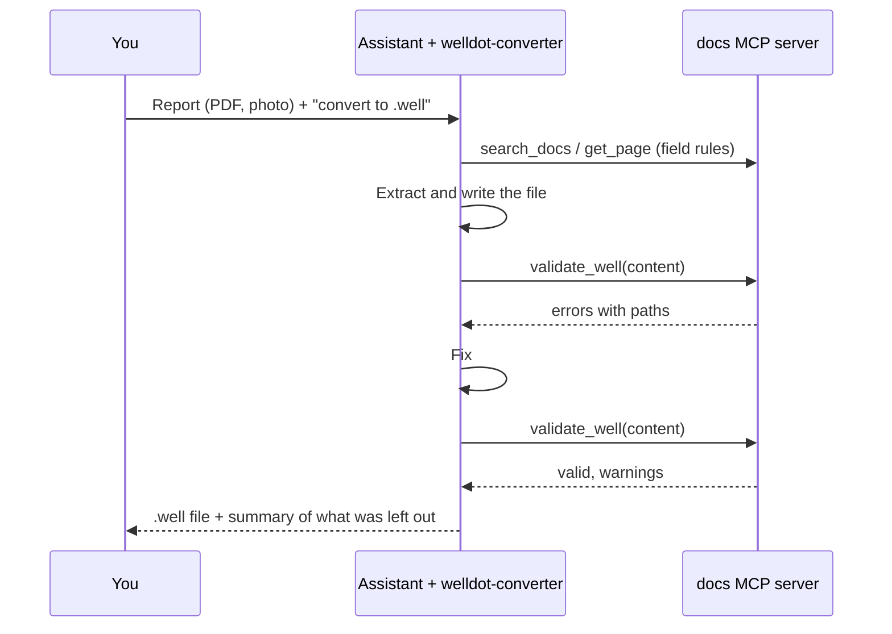

`welldot-converter` is an [Agent Skill](https://agentskills.io): a written procedure that an AI assistant loads and follows. It turns a water well report (PDF, Word document, scan, photo or text, in Portuguese, English, Spanish or another language) into a `.well` file, then reports what it found and what it left out.

The skill lives in the repository at [`.agents/skills/welldot-converter/`](https://github.com/welldothq/welldot/tree/main/.agents/skills/welldot-converter). `SKILL.md` is the procedure, and `references/well-spec.md` is an offline copy of the spec for assistants that cannot browse.

## What it does

1. **Gets the spec.** Reads the current specification, or the bundled copy when offline.
2. **Reads the report**, with the assistant's own file and vision tools.
3. **Extracts the well**: identity, location, construction, lithology, tests, analyses, permits and history, section by section ([what goes where](/format/getting-started/for-geologists)).
4. **Validates** the result: required fields, intervals, units, datetimes with offsets, closed vocabularies.
5. **Delivers** the file with a summary of the sections found, the fields left out on purpose and the free-text values it kept as written.
6. **Asks** about ambiguities instead of guessing.

Its rules match the [conversion guide](/format/guides/converting-a-report): never estimate a number, keep the report's wording, convert units exactly, write datetimes with an offset, keep the drilled depth out of `well_depth`.

## Set it up

::tabs

:::tabs-item{label="Claude Code, Codex, Gemini CLI, Cursor" icon="i-lucide-terminal"}
Clone the repository, or copy `.agents/skills/welldot-converter/` into your own project. These clients discover skills in `.agents/skills/` (Claude Code through the `.claude/skills/` link) with no configuration. The assistant activates the skill when you ask it to convert a report.
:::

:::tabs-item{label="Claude.ai" icon="i-lucide-message-square"}
Upload the `welldot-converter` folder as a skill in **Settings → Capabilities → Skills**, then attach a report and ask for a `.well` file.
:::

:::tabs-item{label="ChatGPT, Gemini Gems" icon="i-lucide-message-circle"}
These do not load skill folders. Create a ChatGPT Project or a Gemini Gem, add `SKILL.md` and `references/well-spec.md` as knowledge files, and paste the instruction block from the skill's [README](https://github.com/welldothq/welldot/blob/main/.agents/skills/welldot-converter/README.md) into the instructions.
:::

::

## Close the loop with validation

Connect the same assistant to the [docs MCP server](/ai/mcp). The skill tells it to run `validate_well` on every file it produces and to fix each reported error before handing the file over. With MCP connected, it can also look up a field in the spec with `search_docs` instead of relying on memory.

## Review the result

The assistant's summary tells you where to look. Then:

- Open the file in [welldot.org](https://welldot.org) and compare the drawn profile with the report's drawing.
- Check the numbers in the tables: depths, diameters, levels, rates.
- Read the fields it says it left out, and fill them only from the report.

The [review checklist](/format/guides/converting-a-report#review-checklist) has the full list.

::caution
Conversion quality depends on the assistant and on the scan. Handwritten logs, low-resolution scans and tables split across pages cause most errors. Treat every converted file as a draft until a person has checked it.
::
