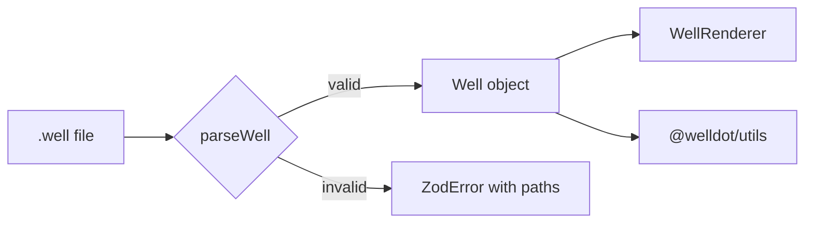
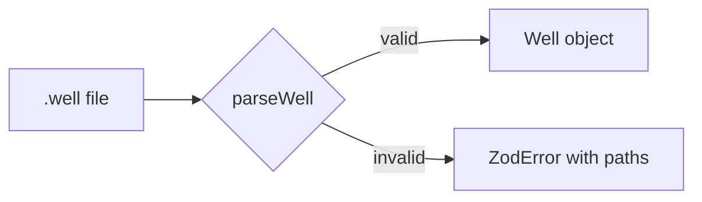

# Content components

This page is the reference for writers. Every block below is shown as it renders, followed by the Markdown (MDC) that produces it. Prefer these over raw HTML.

## Callouts

Four kinds, from the mildest to the strongest. Keep them short: one or two sentences.

::note
A `.well` file is plain JSON. Any text editor can open it.
::

::tip
Start from an example in `packages/core/examples` instead of an empty file.
::

::warning
Depths are in metres from the ground surface. A negative `from` means above ground.
::

::caution
Do not edit files in `spec/` to suit the site. The spec is canonical.
::

```mdc
::note
A `.well` file is plain JSON. Any text editor can open it.
::
```

`::tip`, `::warning` and `::caution` take the same form.

## Do and Don't

Pair a recommended form with the one to avoid. Each side takes text and an optional fenced block.

::do-dont
#do
Give depths as numbers, in metres.

```json
{ "from": 0, "to": 12.5 }
```

#dont
Put units inside the value.

```json
{ "from": "0 m", "to": "12.5 m" }
```

::

````mdc
::do-dont
#do
Give depths as numbers, in metres.

```json
{ "from": 0, "to": 12.5 }
```

#dont
Put units inside the value.

```json
{ "from": "0 m", "to": "12.5 m" }
```
::
````

## Code blocks and code groups

A fence takes a language and an optional `[filename]`. Group alternatives, such as package managers, with `::code-group`. The bracketed name becomes the tab label.

::code-group

```bash [pnpm]
pnpm add @welldot/core
```

```bash [npm]
npm i @welldot/core
```

```bash [yarn]
yarn add @welldot/core
```

::

````mdc
::code-group
```bash [pnpm]
pnpm add @welldot/core
```
```bash [npm]
npm i @welldot/core
```
::
````

### Fence languages

- `well`: a complete `.well` document. CI validates every `well` fence with `parseWell`, so it must be valid as written. It is highlighted as JSON.
- `json`: a fragment, such as a single object or a field. Not validated.
- `ts`, `bash`, `vue`, `yaml`, `md`: as usual.

```ts [read.ts]
import { parseWell } from '@welldot/core';

const well = parseWell(await file.text());
console.log(well.bore_hole.length);
```

## Tabs

Use tabs for content that differs by context but not by language (code alternatives go in a code group).

::tabs
:::tabs-item{label="Browser" icon="i-lucide-globe"}
Open [welldot.org](https://welldot.org) and drop the file on the editor.
:::

:::tabs-item{label="Node" icon="i-lucide-terminal"}
Read the file and call `parseWell` from `@welldot/core`.
:::
::

```mdc
::tabs
:::tabs-item{label="Browser" icon="i-lucide-globe"}
Open welldot.org and drop the file on the editor.
:::

:::tabs-item{label="Node" icon="i-lucide-terminal"}
Read the file and call `parseWell` from `@welldot/core`.
:::
::
```

## Steps

Number a procedure by wrapping its `###` headings in `::steps`.

::steps

### Install the package

Add `@welldot/core` to your project.

### Parse the file

`parseWell` validates the JSON and upgrades a v1 file to v2.

### Use the data

Every field is typed; see the format reference.
::

```mdc
::steps
### Install the package

Add `@welldot/core` to your project.

### Parse the file

`parseWell` validates the JSON and upgrades a v1 file to v2.
::
```

## Diagrams

A `mermaid` fence renders as a diagram that follows the light and dark theme.



````mdc

````

## Live well preview

Draws a profile with `@welldot/render`, next to its source. It runs in the browser only.

### From a bundled example

`example` is the name of a file in `packages/core/examples`, without `.well`.

::well-preview{example="irece-ba-carste-bambui"}
::

```mdc
::well-preview{example="irece-ba-carste-bambui"}
::
```

### From an inline document

Put a complete document in a `well` fence inside the component.

::well-preview

```well
{
  "version": "2.4",
  "name": "Demo well, sandstone aquifer",
  "well_type": "tubular",
  "bore_hole": [
    { "from": 0, "to": 12, "diameter": 304.8 },
    { "from": 12, "to": 60, "diameter": 254 }
  ],
  "surface_case": [{ "from": 0, "to": 12, "diameter": 254 }],
  "well_case": [{ "from": -0.5, "to": 36, "type": "pvc", "diameter": 152.4 }],
  "reduction": [],
  "well_screen": [
    { "from": 36, "to": 54, "type": "pvc", "diameter": 152.4, "screen_slot": 0.75 }
  ],
  "hole_fill": [
    { "from": 0, "to": 12, "type": "seal", "diameter": 254, "description": "Cement seal" },
    { "from": 12, "to": 60, "type": "gravel_pack", "diameter": 254, "description": "Gravel pack, 2–4 mm" }
  ],
  "lithology": [
    { "from": 0, "to": 8, "description": "Red clayey soil", "color": "#9c5a3c", "texture": { "code": 620, "vocabulary": "fgdc" }, "geologic_unit": "Cover", "aquifer_unit": "Aquitard" },
    { "from": 8, "to": 30, "description": "Silty sandstone", "color": "#c9a27a", "texture": { "code": 612, "vocabulary": "fgdc" }, "geologic_unit": "Botucatu Formation", "aquifer_unit": "Guarani" },
    { "from": 30, "to": 60, "description": "Medium-grained sandstone", "color": "#e0c48f", "texture": { "code": 607, "vocabulary": "fgdc" }, "geologic_unit": "Botucatu Formation", "aquifer_unit": "Guarani" }
  ],
  "fractures": [],
  "caves": []
}
```

::

````mdc
::well-preview
```well
{ "version": "2.4", "name": "…", … }
```
::
````

### Invalid input

When the source does not validate, the preview lists the errors with their paths instead of drawing. This snippet is incomplete on purpose, so it uses a `json` fence, which CI does not validate.

::well-preview

```json
{
  "version": "2.4",
  "name": "Half-written well",
  "bore_hole": [{ "from": 0, "to": "sixty", "diameter": 254 }]
}
```

::
