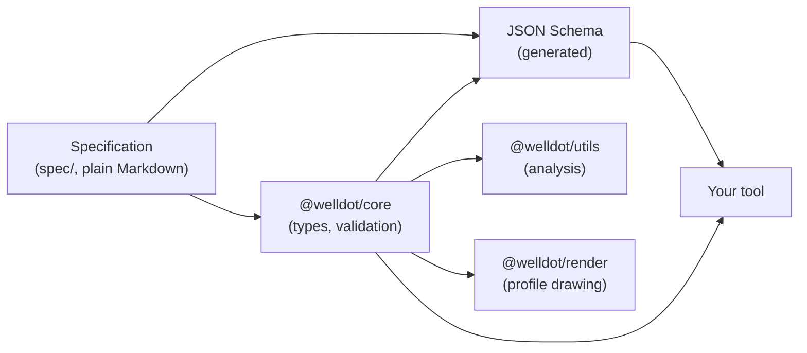

`.well` is an open file format for water well data. One file describes one well: how it was built, what rock it crosses, what was measured in it and what happened to it over its life. The file is plain JSON, so it opens in any text editor and any programming language can read it.

## The problem

Most well records live in scanned drilling reports, PDF profiles, spreadsheets and the closed formats of individual programs. A person can read them; software cannot. Comparing a hundred wells means retyping a hundred reports, and a profile drawn in one program cannot be edited in another. Registries, consultants and researchers each rebuild the same data by hand.

A `.well` file records the same facts once, as structured data that can be validated, searched, compared, drawn and archived.

## What a file holds

| Part          | What it records                                                                          | Main blocks                                                                                                     |
| ------------- | ---------------------------------------------------------------------------------------- | --------------------------------------------------------------------------------------------------------------- |
| Identity      | Name, construction method, purpose, driller, location, registry identifiers              | `name`, `well_type`, `well_purpose`, `location`, `well_id`                                                      |
| Construction  | Borehole, casing, screens, reductions, gravel pack and seals, centralizers, wellhead pad | `bore_hole`, `well_case`, `well_screen`, `reduction`, `surface_case`, `hole_fill`, `centralizers`, `cement_pad` |
| Geology       | Lithological column, fractures, cavities                                                 | `lithology`, `fractures`, `caves`                                                                               |
| Hydraulics    | Water levels, pumping tests, interpreted aquifer parameters                              | `hydrodynamic_events`, `aquifer_analysis`                                                                       |
| Operation     | History log, pumps, permits, meters, production, operating regime, documents             | `history_logs`, `pump_installations`, `permits`, `meters`, `production`, `operating_regime`, `attachments`      |
| Water quality | Samples and their field and laboratory results                                           | `water_samples`                                                                                                 |

The full list, in order, is the [top-level structure](/format/spec/v2/format-reference#top-level-structure) in the specification. Every object has a [reference page](/format/reference/objects) generated from the schema.

## What it is for

The specification names three uses ([Purpose](/format/spec/v2/overview#purpose)):

- **Visualization.** Enough construction and geological detail to draw an accurate well profile at true depth scale.
- **Registration.** A complete static record that can be submitted to a regulator, stored in a registry and archived.
- **Research.** Structured geology, tests and analyses that support comparison across many wells.

## The pieces

- The **specification** is the standard. It is versioned Markdown in the [`spec/` folder](https://github.com/welldothq/welldot/tree/main/spec) of the repository, and this site renders it under [Specification](/format/spec).
- The **JSON Schema** is generated from the reference implementation and published at [`https://welldot.org/schema/v2/well.schema.json`](https://welldot.org/schema/v2/well.schema.json). See [JSON Schema](/format/reference/json-schema).
- **[`@welldot/core`](/core)** is the TypeScript reference implementation: types, validators and serialization. [`@welldot/utils`](/utils) analyzes a well, and [`@welldot/render`](/render) draws it.
- **[welldot.org](https://welldot.org)** is a free web editor built on these packages. It is not required: any program that follows the spec can read and write `.well` files.

## Principles in short

The [design principles](/format/spec/v2/overview#design-principles) shape every field. The ones a new reader meets first:

- **Self-describing.** Field names are written out in full (`well_screen`, `static_level`), so a file can be read without the spec at hand.
- **One unit per quantity.** Depths are meters, diameters millimeters, flow rates m³/h. The file never declares units. See [Units and precision](/format/concepts/units-and-precision).
- **Ground level is zero.** Depths are measured down from the ground surface. See [Depths and intervals](/format/concepts/depths-and-intervals).
- **Incomplete is valid.** A record with only a static level is still a valid record. Unknown values are left out, not invented.
- **Open to extension.** Fields and blocks prefixed with `x-` carry data the spec does not define, and every reader keeps them. See [Extensibility](/format/concepts/extensibility).

## Next

- [For geologists](/format/getting-started/for-geologists): how the parts of a drilling report map onto the file.
- [For developers](/format/getting-started/for-developers): reading and validating files from code.
- [Your first .well file](/format/getting-started/first-well-file): a small file written by hand.
