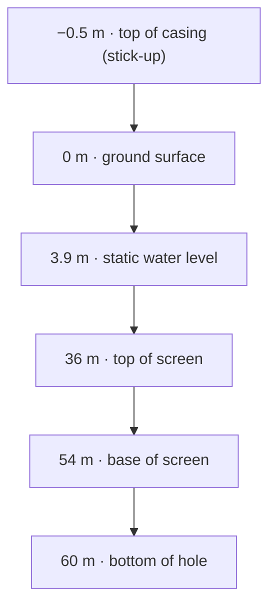

Every position along a well is a depth in meters, measured from the ground surface. Ground level is zero and depth increases downward. This single reference is used by the construction, the geology, the water levels and the sampling points, so they can be drawn and compared on one scale.

The rule is a [design principle](/format/spec/v2/overview#design-principles) ("ground level as zero") and is stated for levels in the [level sign convention](/format/spec/v2/format-reference#level-sign-convention).

## Intervals

Most components occupy a stretch of the hole and are written as an interval: `from` is the top and `to` is the bottom.

```json
{ "from": 36, "to": 54, "type": "pvc", "diameter": 168.3, "screen_slot": 0.75 }
```

A screen from 36 to 54 m, a sandstone layer from 8 to 30 m and a gravel pack from 30 to 60 m are written the same way. `from` and `to` are reserved for depth intervals in meters; time periods use `period_start` and `period_end` ([naming rules](/format/spec/v2/format-reference#naming-rules-since-v23)).

A few things are points rather than intervals: a fracture has a single `depth`, and a water level is a single depth reading.



## Above the ground: negative depths

Anything above the ground surface has a negative depth.

- **Stick-up.** A casing that rises 0.5 m above the ground starts at `"from": -0.5`. Renderers draw it above the wellhead pad.
- **Flowing wells.** A water level 3.98 m above the ground is written `"static_level": -3.98`. This is how the format records an artesian (flowing) condition, instead of a special well type ([`well_type`](/format/spec/v2/format-reference#well_type--recommended-values)).

The exception is the pump intake depth (`pump_installations[].intake_depth`), an equipment position that is always positive.

::do-dont
#do
Record a flowing well as a tubular well with a negative static level.

```json
{ "well_type": "tubular" }
{ "type": "spot_measurement", "static_level": -3.98 }
```

#dont
Use the deprecated `artesian` type, or a positive level with a note.

```json
{ "well_type": "artesian" }
{ "type": "spot_measurement", "static_level": 3.98, "notes": "above ground" }
```

::

## Total depth and usable depth

The well's drilled depth is the deepest `to` of its construction. It does not need its own field: software reads it from the data (`calculatedWellDepth` in [`@welldot/core`](/core/api/functions/calculatedWellDepth)).

`well_depth` is something else: the depth that is usable now, as measured or reported. It can be shallower than the drilled depth when the well has silted up or was partly backfilled ([core identity fields](/format/spec/v2/format-reference#core-identity)). Leave it out unless someone measured it.

## Overlaps and gaps

The format does not require intervals of different blocks to line up. A screen sits inside a borehole interval, a gravel pack around several screens, a lithology layer across a casing joint. Within one block, real reports sometimes contain gaps or overlaps; the [inconsistent data example](/format/reference/examples) keeps them on purpose. Validation checks types and required fields, not geometry, so such a file is still valid. Editors and analysis tools may warn about it.

## Elevation is separate

The ground elevation of the wellhead is stored once in `location.elevation`, in meters above the WGS84 ellipsoid or the datum named in `location.properties.elevation_datum` ([location](/format/spec/v2/format-reference#location)). To get the elevation of a point in the well, subtract its depth from that elevation.

## Related

- [Units and precision](/format/concepts/units-and-precision)
- The construction schemas: [`BoreHole`](/format/spec/v2/object-schemas#borehole--bore_hole), [`WellCase`](/format/spec/v2/object-schemas#wellcase--well_case), [`WellScreen`](/format/spec/v2/object-schemas#wellscreen--well_screen), [`HoleFill`](/format/spec/v2/object-schemas#holefill--hole_fill)
