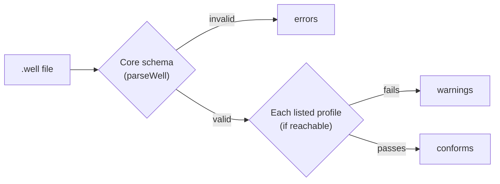

The core format is deliberately neutral: it does not know any country's rules. A **profile** is how a regulator, a utility or a research network adds its own requirements on top. A profile is a JSON Schema published at an HTTPS address. A file lists the profiles it claims to follow in `profiles`:

```json
"profiles": [
  "https://welldot.org/profiles/brazil-ana/v1/schema.json"
]
```

The rules for profiles are in [`profiles`](/format/spec/v2/format-reference#profiles) in the format reference.

## What a profile can do

A profile can make an optional field required, restrict an open vocabulary to certain values, demand a particular `x-` extension, or require certain water quality parameters for a monitoring program ([profile schema requirements](/format/spec/v2/format-reference#profile-schema-requirements)). It usually extends the canonical schema with `allOf` and adds its own constraints.

For example, a registry could require `well_id`, `location` and `construction_date`, and limit `well_purpose` to the uses it recognizes. A drinking water program could require nitrate, coliforms and turbidity in every sample ([regulatory profiles](/format/spec/v2/water-quality#regulatory-profiles)).

## Conformance is a claim

Listing a profile is a statement by the author, not a guarantee. A profile-aware reader validates the file against each profile it can reach and reports failures as **warnings**. A profile that cannot be downloaded is ignored, and a file is never rejected because of one ([profile validation](/format/spec/v2/format-reference#profile-validation)). A file that is valid `.well` stays valid everywhere.



## Profiles and jurisdiction

National drinking water limits are not written into files either. They are data that software picks at display time (`@welldot/core` ships WHO, EU and Brazilian limit sets). Local obligations, such as which parameters must be sampled, enter through profiles. See [jurisdiction neutrality](/format/spec/v2/overview#design-principles) in the design principles and [limit sets](/format/spec/v2/water-quality#limit-sets-are-not-part-of-the-file).

## Status

The `profiles` field and its rules are part of v2. No official profile is published yet; the `spec/profiles/` folder is reserved for them. If you need one for your agency or program, open an issue on [GitHub](https://github.com/welldothq/welldot/issues). The [Relationship to GWML2](/format/spec/v2/interoperability#profiles-for-regulatory-adoption) section describes how profiles support regulatory adoption.
