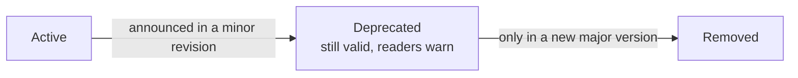

Every `.well` file states the version of the format it follows in `version`. Readers use it to decide how to read the file, and to reject a file they cannot read rather than misread it.

## How versions are written

| `version` | Meaning                                                                         |
| --------- | ------------------------------------------------------------------------------- |
| `1`       | The first version: construction and geology only.                               |
| `2`       | Version 2, revisions 2.0 to 2.3 (the revision is not stated).                   |
| `"2.4"`   | Version 2, revision 2.4. Since 2.4 the revision is written as a string `"M.m"`. |

Revisions are compared as two integers, never as text: `"2.10"` comes after `"2.9"`. Patch levels such as `"2.4.1"` are not allowed. See [Versioning](/format/spec/v2/format-reference#versioning).

::warning
`@welldot/core` 0.4.0 and earlier reject `"2.4"` files. This is the one intentional break in version 2. Upgrade the software that reads your files before writing 2.4 files.
::

## What a reader does

The full rules are in [parser version handling](/format/spec/v2/format-reference#parser-version-handling). In short:

- A v2 reader accepts `1`, `2` and any `"2.x"`. A v1 file is upgraded on read: flat coordinates become `location`, `fgdc_texture` becomes `texture`, `screen_slot_mm` becomes `screen_slot` ([changes from v1](/format/spec/v2/overview#changes-from-v1)).
- A newer minor revision (say a future `"2.9"`) is still read as v2. Fields the reader does not know are kept, not dropped.
- A version that is malformed (`2.4` as a number, `"v2.4"`) or from an unknown major version (`3`, `"3.0"`) is rejected with an error that names it.

## Minor revisions are additive

Within version 2, each revision only adds: new optional fields, new blocks, new recommended values and clarifications. It never removes a field or changes its meaning, so every valid 2.3 file is valid 2.4 once its `version` is updated ([deprecation policy](/format/spec/v2/format-reference#deprecation-policy)). The [changelog](/format/changelog) lists what each revision added.

## Deprecation

A field or value goes through three states ([field lifecycle](/format/spec/v2/format-reference#field-lifecycle)):

A deprecated field is still accepted and preserved. Readers may warn and suggest the replacement, and editors may offer to migrate it, but only when the user asks ([parser behavior](/format/spec/v2/format-reference#parser-behavior)). Removal happens only in a new major version, with a documented rule for reading old files.

The one deprecation in version 2 so far is `well_type: "artesian"` (since 2.1, removal in v3): an artesian well is usually a `tubular` well with a negative static level ([`well_type`](/format/spec/v2/format-reference#well_type--recommended-values)).

## What to write today

- New files: `"version": "2.4"`. `serializeWell` from `@welldot/core` writes it for you.
- Existing files with `"version": 2` stay valid. Rewriting them as `"2.4"` is safe once all your readers are on `@welldot/core` 0.5.0 or later.
- Archives of v1 files can stay as they are; every v2 reader upgrades them on read.

## Related

- [Changelog](/format/changelog)
- [v1 specification (archived)](/format/spec/v1/well-format)
- [Versions and time zones](/core/guides/versions-and-time-zones) in `@welldot/core`
