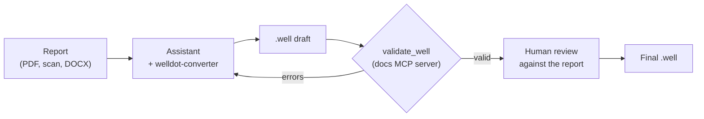

Most well data starts as a document: a drilling report, a well completion log, a pumping test sheet, a laboratory report. This guide shows how to turn one into a `.well` file and what to check before you trust the result.

## Choose a route

| Route                                                                      | Good for                                                                                                           |
| -------------------------------------------------------------------------- | ------------------------------------------------------------------------------------------------------------------ |
| The [welldot.org](https://welldot.org) editor                              | One well at a time, with forms and a live profile. Saves a `.well` file.                                           |
| By hand                                                                    | Short reports, or fixing a converted file. See [Writing a .well by hand](/format/guides/writing-by-hand).          |
| An AI assistant with the [`welldot-converter` skill](/ai/conversion-skill) | PDFs, scans and photos, in any language. Fast, but always reviewed.                                                |
| A script                                                                   | Many records from one source, such as a registry export. See [Building on .well](/format/guides/building-on-well). |

## Map the report

Whatever the route, the same mapping applies. The [For geologists](/format/getting-started/for-geologists) page goes through it in detail.

| Section of the report                                   | Blocks                                                                                                          |
| ------------------------------------------------------- | --------------------------------------------------------------------------------------------------------------- |
| Header (name, owner, location, dates, registry numbers) | `name`, `well_type`, `well_purpose`, `location`, `well_id`, `well_driller`, `construction_date`                 |
| Lithological description                                | `lithology`, `fractures`, `caves`                                                                               |
| Construction profile                                    | `bore_hole`, `well_case`, `well_screen`, `reduction`, `surface_case`, `hole_fill`, `centralizers`, `cement_pad` |
| Pumping test sheet                                      | `hydrodynamic_events` (the readings), `aquifer_analysis` (the interpretation)                                   |
| Laboratory report                                       | `water_samples`                                                                                                 |
| Permits, maintenance records                            | `permits`, `history_logs`, `pump_installations`, `meters`                                                       |

## Rules that matter most

These are the mistakes that produce a valid but wrong file:

- **Never estimate a number.** If the report does not give a value, leave the field out. A guessed diameter or interpolated reading cannot be told apart from a measured one.
- **Keep the report's words.** Descriptions and notes stay in the original language and wording. In open vocabulary fields, such as casing material, use the recommended value when the report states it, otherwise an `x-` value; an unprefixed custom value is valid but not recommended ([custom vocabulary values](/format/spec/v2/format-reference#custom-vocabulary-values--x--prefix)).
- **Convert units exactly.** Inches to millimeters (× 25.4), feet to meters (× 0.3048), slot numbers to millimeters, gallons per minute to m³/h ([Units](/format/spec/v2/format-reference#units)). Use real outer diameters for casing ([as-built convention](/format/spec/v2/format-reference#diameter-and-the-as-built-convention)).
- **Convert projected coordinates.** UTM coordinates must become latitude and longitude; keep the source system in `original_crs` ([CRS scope](/format/spec/v2/format-reference#crs-scope)).
- **Total depth is not usable depth.** The drilled depth belongs in the deepest `bore_hole[].to`. `well_depth` is only for a measured current depth.
- **Datetimes carry an offset.** Test and sample times are written with the local UTC offset, for example `-03:00` in most of Brazil ([datetime conventions](/format/spec/v2/format-reference#datetime-conventions)).

::do-dont
#do
Write what the report states, using the recommended value it names (here "tubo geomecânico", geomechanical PVC), and leave out what it does not say.

```json
{ "from": 0, "to": 36, "type": "geomechanical_pvc", "diameter": 168.3 }
```

#dont
Fill gaps with plausible values or map the material to the nearest recommended word.

```json
{ "from": 0, "to": 36, "type": "pvc", "diameter": 150 }
```

::

## With an AI assistant

The [`welldot-converter` skill](/ai/conversion-skill) is a written procedure an assistant follows to read the report, extract every section, write the file and report what it left out. It works with Claude, ChatGPT, Gemini, Cursor and other assistants.



Connect the assistant to the [docs MCP server](/ai/mcp) so it can check its own output with `validate_well` and look up the spec instead of relying on memory.

::caution
A valid file is not a correct file. Validation checks types and required fields; it cannot know that a casing is 168.3 mm and not 152.4 mm. Compare the drawn profile with the report's drawing, and the numbers with the tables, before you rely on a converted file.
::

## Review checklist

1. The profile drawn at [welldot.org](https://welldot.org) matches the report's construction drawing.
2. Every depth interval in the report has an entry, and no entry has invented depths.
3. Diameters are in millimeters and look plausible (a casing is narrower than its hole).
4. Lithology descriptions are the report's text, and each layer has a sensible texture code.
5. The static level, test rates and durations match the test sheet; levels above ground are negative.
6. The file passes [validation](/format/guides/validating).
7. Anything uncertain is noted in `obs` or a `notes` field rather than silently decided.

## Registry imports

For Brazilian wells registered in SIAGAS, [`@welldot/utils`](/utils/guides/siagas-import) can import a well directly from the registry page, with warnings for anything it could not carry over.
