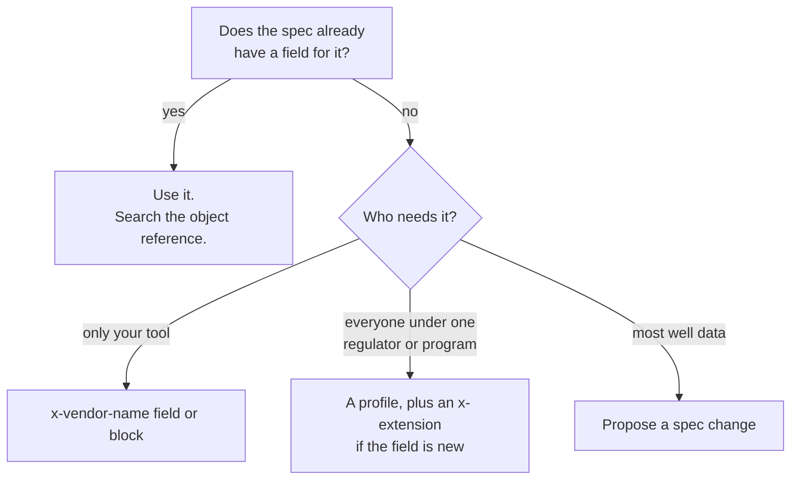

Sooner or later a project needs something the spec does not define: an internal asset code, a field the local regulator asks for, a measurement nobody else takes. This guide shows how to add it without breaking other tools, and how to get it into the format when it is useful to everyone.

## Decide where the data belongs



Before adding anything, search the [object reference](/format/reference/objects) and the [recommended vocabularies](/format/spec/v2/format-reference#recommended-vocabularies). Many needs are already covered: free-text `notes` and `obs`, attachments for documents, open vocabularies that accept any value.

## A local extension

Use the `x-` prefix, with your organization's name, on a field or a whole block ([Extensibility](/format/spec/v2/format-reference#extensibility)):

```json
{
  "version": "2.4",
  "name": "PT-07",
  "x-acme-asset": { "code": "ACM-PT-07", "cost_center": "4410" },
  "well_case": [
    {
      "from": 0,
      "to": 40,
      "type": "carbon_steel",
      "diameter": 219,
      "x-acme-batch": "B-2291"
    }
  ]
}
```

- Prefix with your name (`x-acme-…`) so you do not collide with another tool's `x-custom` (recommended since 2.4).
- Keep units SI and names self-describing, as the rest of the format does ([naming rules](/format/spec/v2/format-reference#naming-rules-since-v23)).
- Do not use an extension to restate a value the spec already holds; two sources for one fact will drift.

Every conforming reader keeps your extension and writes it back unchanged, so the file can pass through other tools safely. [Extensibility](/format/concepts/extensibility) explains the rule.

## A new value in an open vocabulary

Write it with the prefix: `"drilling_method": "x-jetting"`, `"category": "x-site_visit"` ([custom vocabulary values](/format/spec/v2/format-reference#custom-vocabulary-values--x--prefix)). Closed vocabularies, such as `hole_fill[].type`, cannot be extended this way; a new value there needs a spec change.

## Requirements for a group: profiles

When an agency or a monitoring network needs every file to carry certain fields or values, publish a [profile](/format/concepts/profiles): a JSON Schema at an HTTPS address that files list in `profiles`. The profile can require your `x-` extension, so the extension becomes part of the agreement without changing the core format ([profile schema requirements](/format/spec/v2/format-reference#profile-schema-requirements)).

## Propose a change to the format

If an extension would help most people who record wells, propose it for the spec.

::steps

### Open an issue

Describe the data, who records it, where it appears in real reports and an example. Format changes start with an issue on [GitHub](https://github.com/welldothq/welldot/issues); see the repository's [contributing guide](https://github.com/welldothq/welldot/blob/main/CONTRIBUTING.md).

### Agree on the shape

Field name, type, unit, whether it is required, and which block it belongs to. The new field must fit the [design principles](/format/spec/v2/overview#design-principles): SI units, no derived values, no jurisdiction-specific meaning.

### Change the spec first

The spec text in `spec/` is edited first, in plain Markdown, then the reference implementation, the JSON Schema and the docs. The [update rules](/contributing/update-rules) list everything that changes together.

::

A new optional field ships in a minor revision and never breaks existing files ([deprecation policy](/format/spec/v2/format-reference#deprecation-policy)). An `x-` vocabulary value that is adopted stays equivalent to the new value until the next major version ([vocabulary value promotion](/format/spec/v2/format-reference#vocabulary-value-promotion)).
